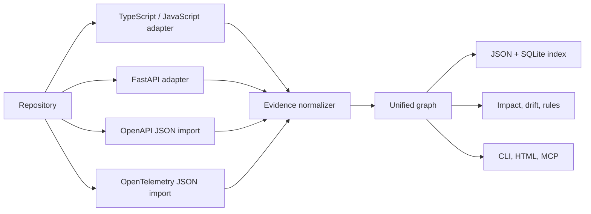

# Architecture

The adapters emit a shared model rather than owning separate graphs. Nodes represent React components (with semantic attributes on their canonical function identity), API routes, client API requests, static assets, functions, tests, source files, database operations, API contracts, and runtime traces. Edges carry a relation, status, analyzer method, exact file and line, and optional trace/time provenance. Client requests do not create server-route nodes: a `TARGETS` edge is emitted only when a route declaration or imported contract provides a supported match; otherwise the request remains explicitly unresolved.

An endpoint is identified by a canonical `METHOD /path/{parameter}` key. This lets `/api/orders/:id` and `/api/orders/{id}` join without pretending arbitrary dynamic URLs are understood.

The persistence layer writes the same graph to JSON for inspection and SQLite for local queries, and keeps the last 50 scan summaries in `history.json`. Each summary separates unresolved client requests, server routes not found in the scanned scope, unverified contracts, test coverage status, and stale evidence. The score includes its formula and is a risk signal, not a prediction of a defect. SQLite is local, simple to remove, and sufficient until real workload data proves otherwise.
