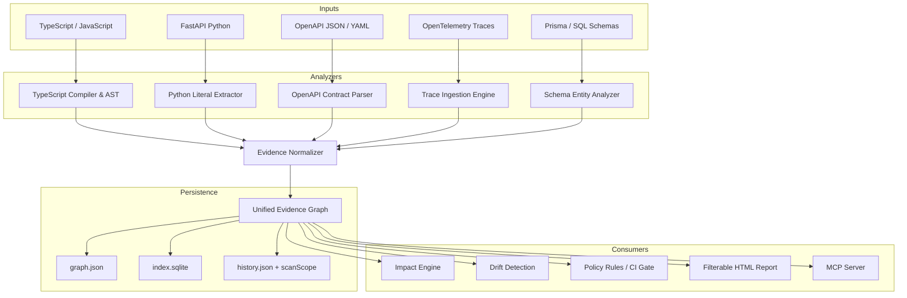

# Architecture



The adapters emit a shared model rather than owning separate graphs:
- **Nodes**: Represent React components (with semantic attributes on their canonical function identity), React context objects (`context`), API routes, client API requests, API response fields (`api_field`), static assets, functions, tests, source files, database operations, database entities, API contracts, and runtime traces.
- **Edges**: Carry a relation, status (`statically_established`, `observed`, `inferred`, `stale`, `unresolved`), analyzer method, exact source file and line, and optional trace/time provenance.
- **Canonical Relations (No Duplication)**: Relationships are strictly canonical (e.g. `file DECLARES symbol`, `App RENDERS AuthProvider`). Inverted edges like `DEFINED_IN` are intentionally not stored; reverse navigation is queried on incoming edges.
- **React Context Graph**:
  ```text
  App
    └── RENDERS → AuthProvider
                     └── PROVIDES_CONTEXT → AuthContext
                                               ↑
                                       CONSUMES_CONTEXT
                                            useAuth()
  ```
  Provider components maintain a single `function` identity (`isProvider: true`), while context objects exist as distinct `context` nodes created via `createContext()`.
- **API Request Identity Normalization**: Requests receive stable keys (`request:${file}:${line}:${METHOD} ${path}`). Statically resolved paths do not contain `"unresolved:"` prefixes. Path resolution (`pathResolution`) and origin matching (`originResolution`) are tracked in attributes.
- **Response Fields**: Destructured and property-accessed fields are mapped as `api_field` nodes connected to client functions via `READS_FIELD` and `CONSUMES_FIELD` (`inferred`), and linked to OpenAPI schemas via `DECLARES_FIELD` (`statically_established`).

An endpoint is identified by a canonical `METHOD /path/{parameter}` key. This lets `/api/orders/:id` and `/api/orders/{id}` join without pretending arbitrary dynamic URLs are understood.

The persistence layer writes the same graph to JSON for inspection and SQLite for local queries, and keeps the last 50 scan summaries in `history.json`. Each history summary records:
- `scanScope`: Explicit coverage states across `frontend`, `backend`, `apiContracts`, `tests`, and `runtimeTraces`.
- `revision`: Git commit SHA for auditability.
- `canonicalEdges`: Count of distinct stored facts.
- `risk`: Explicit signals separating unresolved client requests, server routes not found in scan, unverified contracts, discovered tests, mapped endpoints, unmapped tests, and coverage status (`complete`, `partial`, `not_analyzed`).
- The score includes its formula and is a risk signal, not a prediction of a defect. SQLite is local, simple to remove, and sufficient until real workload data proves otherwise.
